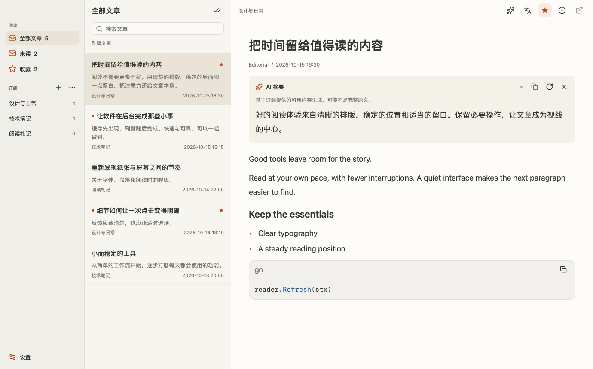
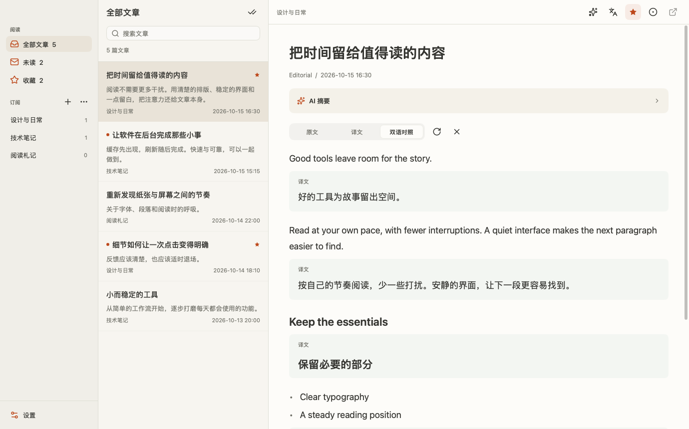
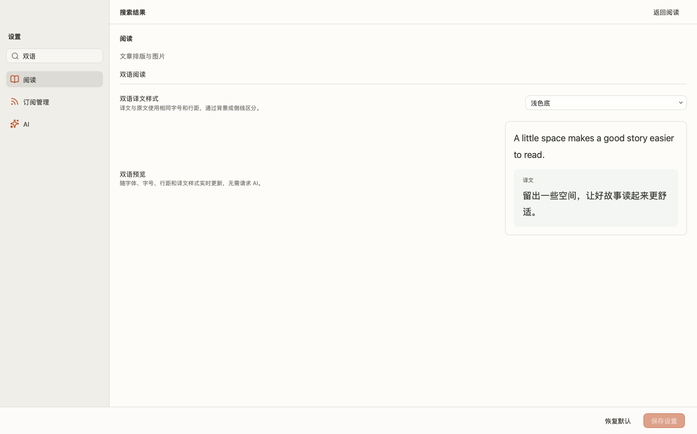

# GoRss

[English](README.md)

GoRss 是基于 [MyGo](https://mygo.egoist.dev/) 与 [Onevra](https://github.com/oneo-me/onevra) 制作的 Apple Silicon Mac 原生 RSS/Atom 阅读器，采用浅色三栏界面。



## 功能

启动时先显示本地缓存文章，再在后台刷新全部订阅。刷新失败保留缓存并显示错误。订阅最多 4 个并发刷新，支持 ETag 与 Last-Modified 条件请求；服务器返回 304 时复用文章缓存。支持添加、删除和刷新 RSS/Atom 订阅，搜索文章标题及摘要，筛选未读与收藏文章，以及 OPML 导入导出。正文支持 Markdown、图片、表格、引用和代码高亮。RSS 的 HTML 转换为 Markdown 显示，不复现复杂网页布局或交互。

阅读设置提供可搜索的 Mac 已安装字体下拉列表、字号、行距、正文宽度和图片开关。界面字体独立于阅读排版，三栏通过暖色表面层次区分。macOS 一体式顶栏将文章列表和阅读工具栏移至顶部，保留系统窗口按钮；设置页适配窄窗口与全屏布局。设置与阅读状态保存在本地。订阅提供的正文可以缓存阅读，外部图片需要联网；订阅只提供摘要时不会额外抓取网页全文。

## AI 阅读

AI 默认关闭。文章工具栏提供按需摘要、全文翻译和原文／译文／双语切换；正文选中后右键可翻译最多 4,000 字。长文按 Markdown 结构分批翻译，逐批显示并保留成功批次以供失败后重试。重新生成可绕过缓存。翻译保留代码、图片和链接目标，不覆盖 RSS 原文。

AI 支持添加多个 OpenAI 兼容供应商，按供应商分别保存地址、名称、模型、密钥与摘要／翻译提示词；已有自定义 API 和 Magpie 配置继续使用。支持模型搜索、提示词编辑与放弃草稿更改。摘要支持平滑展开与收起，译文模式采用滑动分段切换；收藏和复制提供状态反馈，动效跟随系统「减少动态效果」设置。在「阅读」设置中可选择浅色底、侧线或纯文本译文样式，并实时预览。

在左下角「设置」或 ⌘, 打开统一设置页，阅读类别提供字体、字号、行距、宽度和图片开关；AI 类别独立保存 AI 配置。自定义服务使用 OpenAI 兼容 `/models` 与 `/chat/completions` 接口，填写基础地址、实际模型 ID、语言和超时。Magpie 默认 `http://127.0.0.1:3425/v1`，通过 `/api/hello` 验证身份，再读取 `/v1/models`。协议检测不生成内容；测试模型会发出真实请求。密钥保存／删除是独立操作，空输入不会覆盖已有密钥。详见 [AI 阅读说明](AI_READING.md)。

## 界面预览

<details>
<summary>双语阅读</summary>



</details>

<details>
<summary>阅读设置与双语样式预览</summary>



</details>

## 安装

在本仓库的 [最新发布](https://github.com/RSK21X/GoRss/releases/latest) 页面下载 Apple Silicon DMG 或 ZIP。打开 DMG，将 GoRss 拖入“应用程序”。更新前先退出旧版再替换，已有订阅与设置会保留。

构建要求 macOS 12 或更新版本。安装包未使用 Developer ID 签名或公证；初次打开可能需要在系统设置“隐私与安全性”中明确允许。

## 构建

安装 Go 1.27.1 或更新版本，克隆仓库后在 Mac 上运行：

```bash
go mod tidy
go test ./...
go vet ./...
go run github.com/egoist/mygo/cmd/mygo@v0.5.1 build -platform darwin/arm64
```

产物位于 `build/darwin-arm64/`。也可以执行 `bash build-mac-arm.command`。无需 Node 或网页构建步骤。MyGo 固定为 v0.5.1，Onevra 固定为 v0.2026.6。

应用与构建 CLI 均使用上游 MyGo v0.5.1。划词翻译通过公开接口 `Element.SelectedTexts()` 读取实际选区，无需本地 MyGo 副本或 `replace`。字体列表通过 `ui.FontFamilies()` 读取。

## 设置与数据

点击左下角“设置”的阅读类别或按 ⌘, 调整排版。字体选择立即更新预览，点击“保存设置”后应用到正文并持久保存。新安装字体需重启应用后显示。应用固定为浅色主题。

数据位于 `~/Library/Application Support/GoRss/`：`reader.json` 保存订阅、文章及已读收藏状态；`preferences.json` 保存排版设置。OPML 仅备份订阅。完整备份请在退出应用后复制该目录。`ai.json` 保存 AI 配置但不含密钥；密钥存入 macOS Keychain，`ai-cache/` 保存有界的本地明文派生结果，可删除清理。只有主动触发 AI 操作时才向选定服务发送文章可用正文或所选文字。远程服务要求 HTTPS，HTTP 只允许 loopback；本地缓存也可能含私人文章的译文或摘要。

快捷键为 ⌘N 添加订阅、⌘R 刷新、⌘, 打开设置、⌘W 关闭窗口、⌘Q 退出。

## 验证与限制

1.2.1 的功能更新见 [发布说明](release-v1.2.1.md)，框架测量与后续建议见 [检查报告](MYGO_0.5_REVIEW.md)。已在 Mac 上验证窗口启动与 CoreText 字体列表。原生文件对话框、真实 Keychain 与实际 AI 服务尚未在本次测试中操作。无窗口性能测试不代表 Mac 显示帧率。

AI 默认通过 SSE 流式接收文本。摘要和划词翻译逐步显示；全文翻译显示临时译文预览，仅将校验通过的完整批次写入缓存。可停止生成并重试。不支持流式的服务可关闭流式显示；服务明确拒绝 stream 参数时会回退一次。延迟仍受模型、网络和正文长度影响。双语视图按结构块配对，跨独立块选区受限；无法对齐时提示并可切换译文。超长正文仍有整体排版成本。AI 结果可能有误；摘要仅依据订阅提供的内容。

## 依赖与归属

MyGo 与 Onevra 提供原生窗口、组件、主题和 Markdown 渲染，RSS 解析使用 gofeed。依赖归属见 `THIRD_PARTY_NOTICES.md`。应用图标由项目所有者提供。本仓库没有为应用源码或图标新增授权许可，依赖许可仍然适用。
